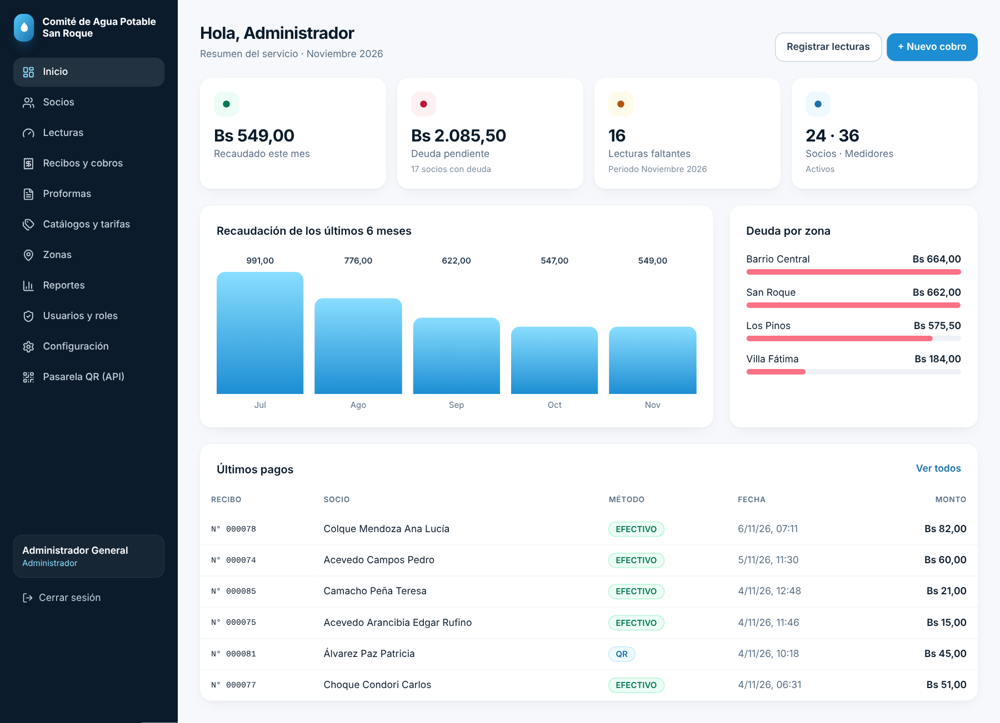
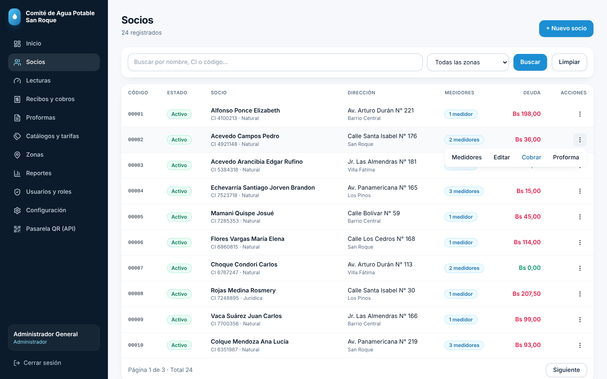
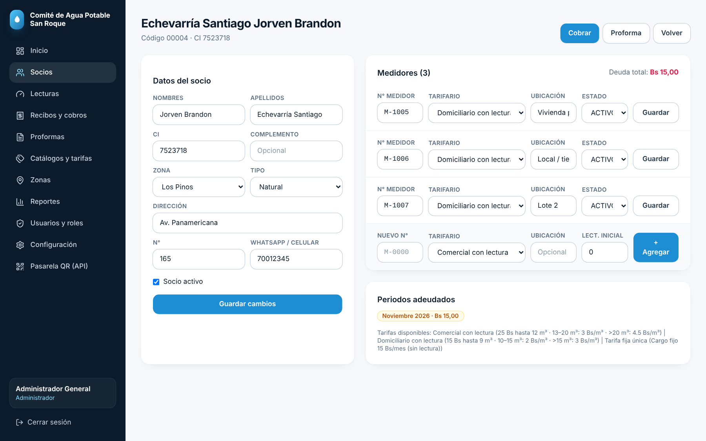
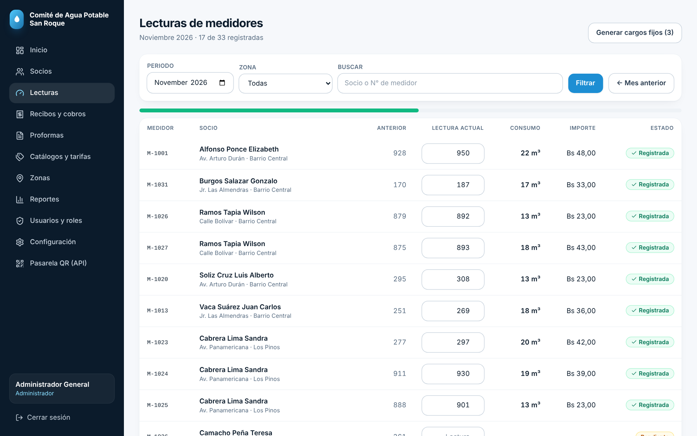
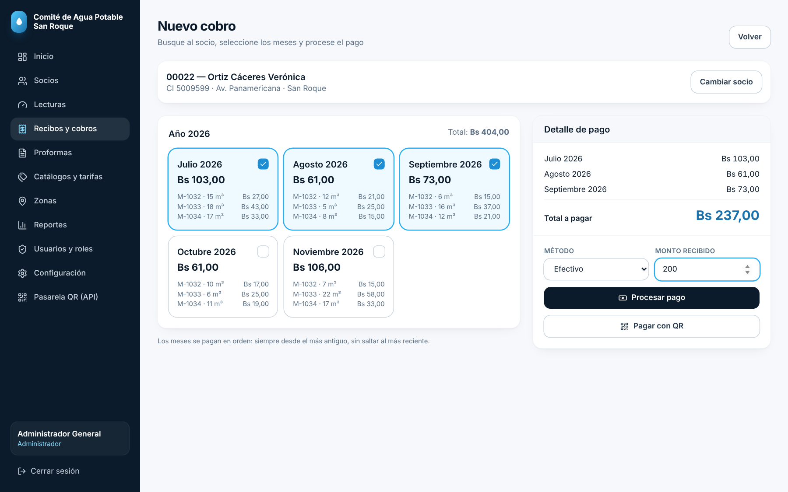
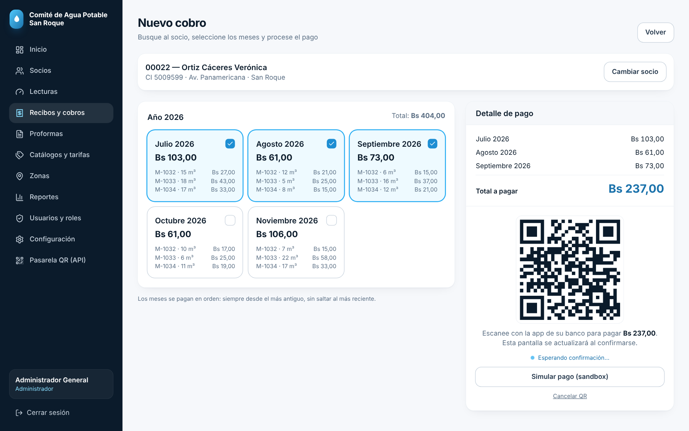
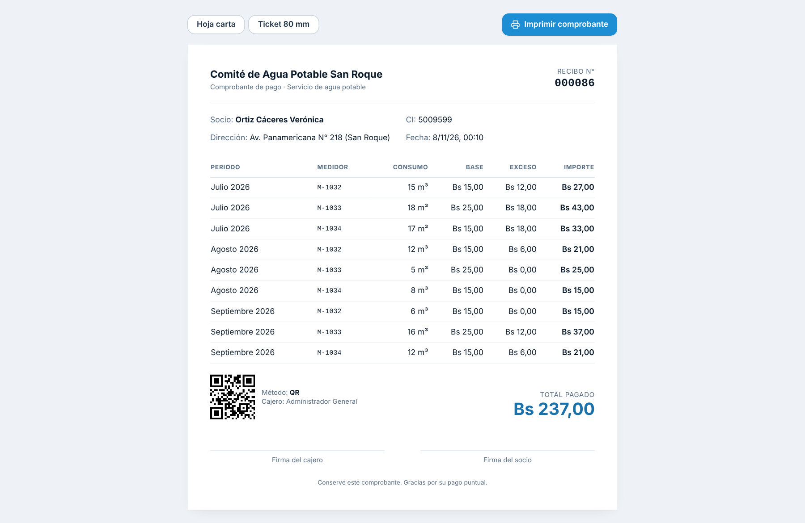
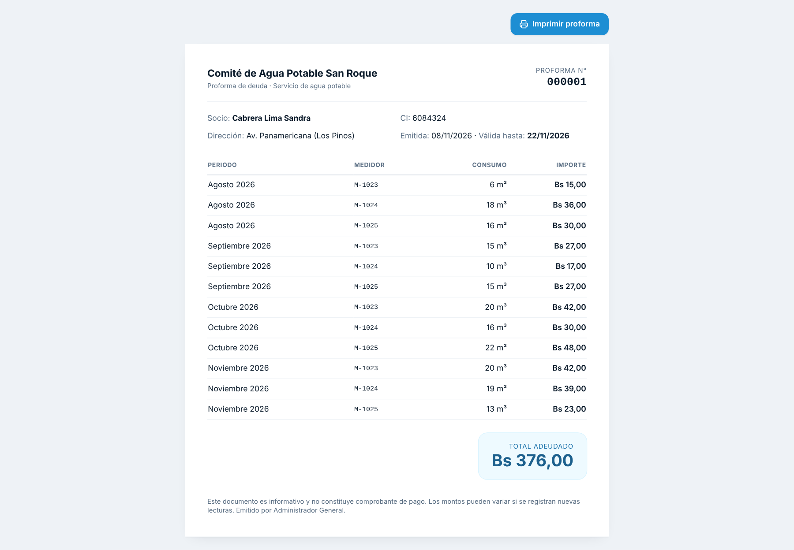
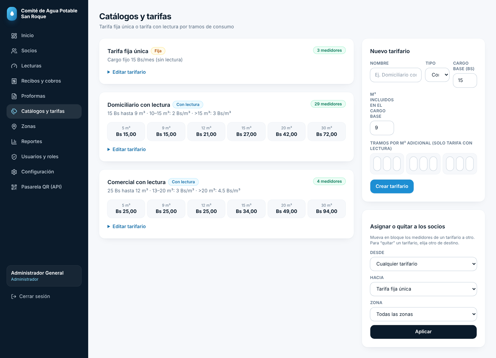
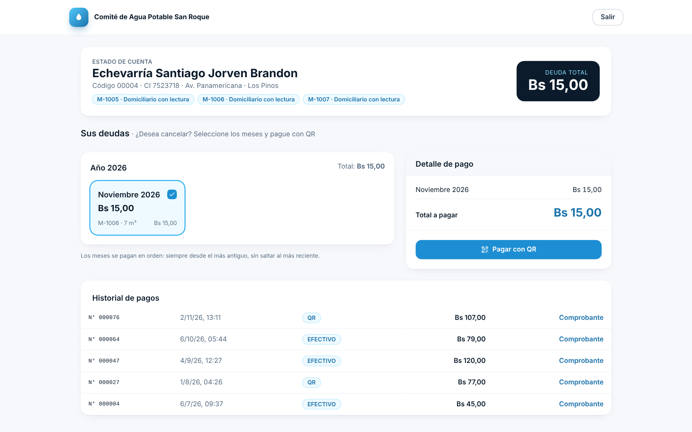

# Sistema de cobro de agua potable

Aplicación web para comités / cooperativas de agua potable: **socios con varios medidores, lectura mensual, tarifario por consumo, cobro FIFO, comprobantes y proformas imprimibles, estado de cuenta público y cobro por QR**.

**Stack:** Next.js 14 (App Router, Server Actions) · TypeScript · PostgreSQL (`pg`, SQL directo) · Tailwind CSS · JWT en cookie httpOnly (`jose`) · `bcryptjs` · `qrcode`.

## Capturas

| | |
|---|---|
|  |  |
|  |  |
|  |  |
|  |  |
|  |  |

## Puesta en marcha

```bash
npm install
docker compose up -d            # PostgreSQL 16 (o use su propio servidor y edite .env)
cp .env.example .env
npm run setup                   # crea tablas + datos de demostración
npm run dev                     # http://localhost:3000
```

Producción: `npm run build && npm start` (defina `AUTH_SECRET` largo y `COOKIE_SECURE=true` detrás de HTTPS).

### Usuarios de demostración (contraseña `admin123`)
| Rol | Correo |
|---|---|
| Administrador | admin@agua.bo |
| Gerente | gerente@agua.bo |
| Cajero | cajero@agua.bo |
| Lector (zona San Roque) | lector@agua.bo |
| Socio | socio@agua.bo |

Estado de cuenta público (sin login): `/estado-cuenta` → CI `7523718` · celular `70012345`.
**Cambie todas las contraseñas y el secreto del webhook antes de usar datos reales.**

## Reglas de negocio implementadas

- **Un socio, varios medidores.** Cada medidor tiene su N°, ubicación, estado (activo/suspendido/baja) y **su propio tarifario**. El cobro agrupa por mes todos los medidores del socio.
- **Lectura.** Lectura anterior automática (última registrada o lectura inicial); no permite lecturas menores; recalcula el cargo al corregir; bloquea periodos ya cobrados. El lector solo ve su zona. Consumo e importe se calculan en vivo.
- **Tarifarios.** *Fija única* (ej. 15 Bs sin lectura) o *con lectura por tramos progresivos*: cargo base incluye N m³; cada m³ adicional se cobra según el tramo.
  Ejemplo domiciliario (15 Bs hasta 9 m³ · 10–15 m³ a 2 Bs · >15 m³ a 3 Bs): 12 m³ → 21 Bs · 20 m³ → 42 Bs · 30 m³ → 72 Bs.
  Asignación masiva o por zona (“mover medidores de un tarifario a otro”) y por medidor individual.
- **Cobro FIFO.** Se pagan los meses desde el más antiguo, sin saltar (validado en interfaz **y** servidor).
- **Comprobantes.** Hoja carta o ticket 80 mm, con detalle por medidor (consumo, base, exceso), QR de verificación, firmas. Anulación solo gerente/administrador, con motivo; los cargos vuelven a pendiente.
- **Proformas.** Selección de cargos (o toda la deuda), vigencia de 15 días, hoja imprimible.
- **QR.** Desde caja y desde el estado de cuenta del socio. Adaptador `lib/qr.ts` + webhook `POST /api/qr/webhook` (header `x-api-key`). Modo *sandbox* para pruebas. **Falta ajustar al contrato real de Vendis** (rutas, campos, firma).
- **Reportes:** deudores, no deudores, recaudación (rango), lecturas faltantes, anulaciones, resultados por zona.
- **Roles:** Administrador (todo) · Gerente (sin usuarios/config/API) · Cajero (socios lectura, cobros, proformas) · Lector (lecturas de su zona) · Socio (solo su cuenta). Zonas: no accesible a cajero ni lector.
- **Auditoría** de pagos, anulaciones, tarifas, usuarios y configuración.

## Estructura
```
app/(app)/…        módulos internos (dashboard, socios, lecturas, recibos, proformas, tarifas, zonas, reportes, admin)
app/imprimir/…     comprobante y proforma (sin menú, listos para imprimir)
app/estado-cuenta  consulta pública del socio (CI + celular → token de 30 min)
app/api/qr/…       webhook y consulta de estado del QR
app/actions.ts     todas las mutaciones (Server Actions) con control de rol
lib/               db, auth, tarifa (cálculo), pagos (FIFO), qr (adaptador), formato
db/schema.sql      esquema PostgreSQL idempotente · scripts/seed.ts datos demo
```

## Pendiente / siguiente nivel
Pruebas automatizadas, límite de intentos de login, foto de evidencia de la lectura, lectura offline en celular, aviso por WhatsApp, multas/reconexión, cierre de caja por cajero, facturación SIN si corresponde, y conexión real con Vendis.

## Decisiones (registradas)

1. **Cobro por medidor individual:** El cajero puede seleccionar medidores individuales dentro de cada periodo para cobro parcial, respetando la regla FIFO (periodos desde el más antiguo sin saltar). Implementado en `components/CobroForm.tsx`.
2. **Corrección de lecturas:** El lector puede modificar una lectura una sola vez con justificación requerida. Solo ADMIN/GERENTE pueden modificar sin límite y eliminar lecturas no pagadas. Implementado en `app/actions.ts` y `components/LecturaRow.tsx`.
3. **Validación de entrada:** Todos los IDs numéricos (`medidorId`, `socioId`, `cargoIds`) se validan antes de consultas SQL para prevenir errores de tipo `NaN`.
4. **Docker multi-stage:** Imagen de producción usa `output: 'standalone'` de Next.js para reducir tamaño y superficie de ataque.
5. **QR sandbox:** Manteniendo modo sandbox por defecto. Falta ajustar `lib/qr.ts` al contrato real de Vendis cuando se entregue la documentación oficial.

## Despliegue en Producción

Consultar `DEPLOY.md` para la guía completa de despliegue en VPS con Docker, Nginx y HTTPS (Certbot).

### Archivos de despliegue incluidos:
- `Dockerfile` — Multi-stage para producción
- `docker-compose.prod.yml` — Orquestación DB + App + Nginx + Certbot
- `nginx.conf` — Configuración HTTPS con redirect HTTP→HTTPS
- `.env.production.example` — Variables de entorno para producción
- `scripts/db_backup.sh` — Respaldo diario de PostgreSQL (Linux)
- `scripts/db_backup.bat` — Respaldo diario de PostgreSQL (Windows)
- `DEPLOY.md` — Guía paso a paso de despliegue

